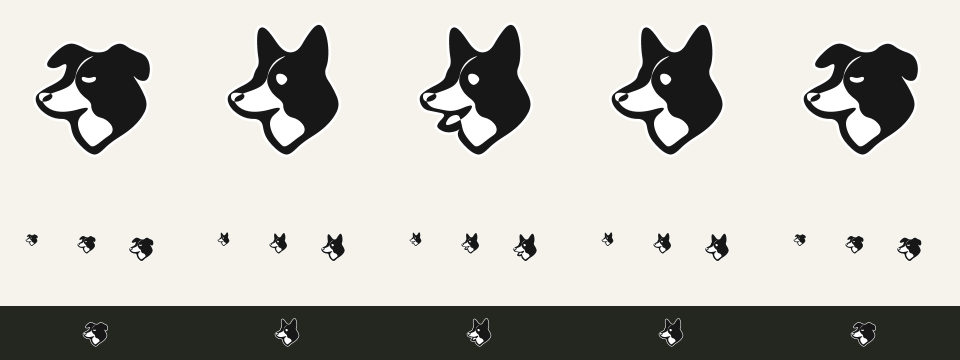

# WUF Watchdog · Minimal Border Collie icon

2026-10-24：依使用者確認的方向，保留左側邊牧輪廓，只簡化線條、塊面與細節。保留直立雙耳、較長口鼻、白色面部與胸口，使用較大的實色區域與簡單眼形。圖標不使用字母構形。

## 狀態語意

| 資產 | 功能 |
| --- | --- |
| sleeping / offline | 垂耳、閉眼，模型休眠或服務未連線 |
| ready / starting | 立耳、睜眼，模型已喚醒或正在載入 |
| running | 立耳、張嘴，正在處理推論請求 |

16／24／32px 與明暗底預覽均已檢查。網頁保留朱紅狗形與暖白底；Windows 使用黑色主體、白色外緣；macOS 使用單色 template，依系統外觀反相。

## 向量來源

`watchdog/assets/watchdog-vectors.json` 定義三種輪廓。Go `wuf-tool icons` 產生 SVG、PNG、ICO、ICNS 與狀態預覽。網頁三種 symbol 與 favicon 同步更新。macOS 選單讀取封裝 Resources 的同名 JSON，以相同二次曲線與 even-odd 填色繪製，避免獨立硬編碼的狗形漂移。

```powershell
& ./runtime/windows/wuf-tool.exe icons --vectors 'C:/LLM_Project/WUF-Watchdog/watchdog/assets/watchdog-vectors.json' --output 'C:/new/icon-output'
```

輸出目錄必須尚未存在。產生後同步資產及網頁內嵌 symbol，重新啟動托盤才會載入新 ICO。

## 驗證與限制

- Go 全部測試與 vet 通過，包含 macOS bundle 攜帶向量檔案的檢查。
- SVG 與網頁三個狀態的路徑一致；JavaScript 語法通過。
- Windows 五種狀態 ICO 部署後逐一比對 SHA256；重啟前檢查沒有正在處理的推論請求。
- 真實 Riva 引擎喚醒後觀察到 dog-ready 立耳；休眠後觀察到 dog-sleeping 垂耳，並還原測試前的休眠狀態。
- macOS bundle layout 檢查向量 JSON 與來源一致；Swift 編譯與實際選單外觀仍需在 Mac 上確認。
- 舊資產、Swift 來源與網頁保存在 `C:/LLM_Project/_backup/wuf-watchdog-minimal-icon-20261024/`，既有未提交變更保留。


